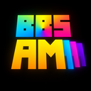

# BBS AM (AfterMotion)

**Послеобразы для BBS FS: затухающие копии персонажа прямо из клипа на таймлайне.**

## Что умеет
- Новый клип **«Послеобраз»** — кладётся поверх клипа «Вид», все настройки внутри клипа
- Копии при движении или постоянно, даже когда персонаж стоит
- Цвет: оригинал, один цвет, градиент, два по очереди, радуга
- Снос копий вправо, влево, вверх, вниз, вперёд, назад
- Сохраняет позу персонажа (бег, прыжок и т. д.)
- Настройки для слабых ПК: лимит копий, время жизни, по умолчанию выключено, включается клипом

## Как пользоваться
«Добавить клип» → «Послеобраз» → слой выше «Вид» → нажми на клип и настрой справа.

## Требования
Minecraft 1.20.1 · Fabric Loader · Fabric API · BBS FS 2.7

Автор: KDR4 · Документация: `DOCS.md` · Лицензия: MIT

---

# BBS AM (AfterMotion) — English

**Fading afterimages for BBS FS, controlled by a clip on the film timeline.**

- New **"Afterimage"** clip type, placed above the camera clip; every setting is inside the clip
- Ghosts while moving or constantly, even when standing still
- Colors: original, solid, gradient, two alternating, rainbow
- Drift ghosts right, left, up, down, forward, back
- Keeps the character's pose (running, jumping, etc.)
- Low-end friendly: ghost limit, lifetime and off by default, enabled by a clip

**Usage:** Add clip → Afterimage → layer above the camera clip → click the clip and configure on the right.

**Requires:** Minecraft 1.20.1, Fabric Loader, Fabric API, BBS FS 2.7. Author: KDR4. License: MIT.
